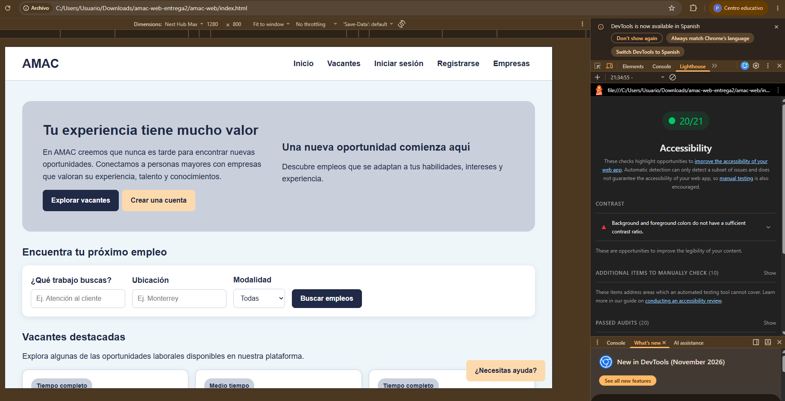
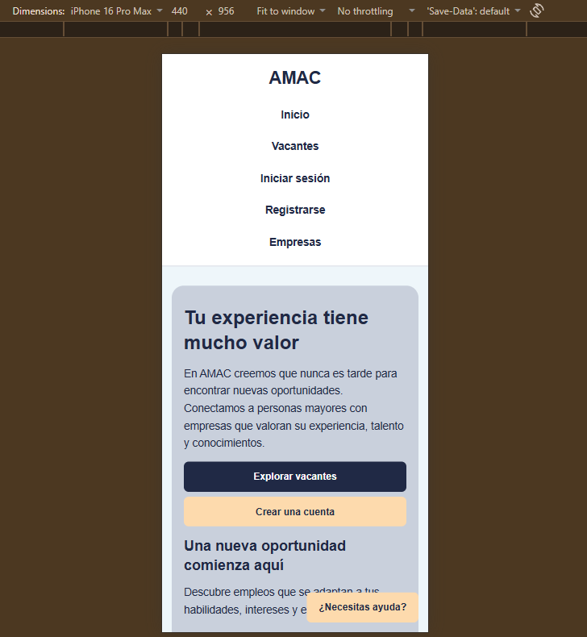
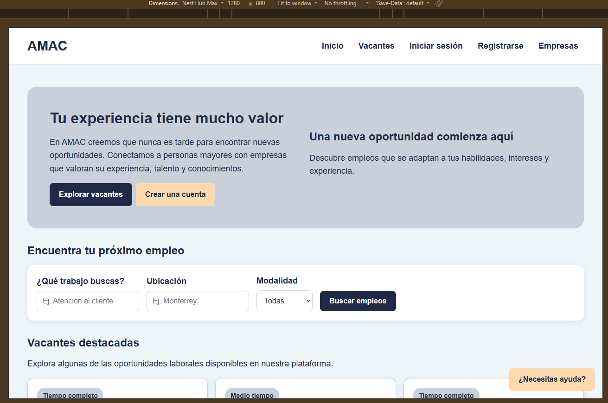

# AMAC — Bolsa de trabajo

Integrantes: Patricio Fonseca Ramírez, hizo todo el código

Paleta de colores y tipografías
    /* Colores principales */
    --color-primario: #202945;
    --color-primario-oscuro: #202945;
    --color-secundario: #FDDAAD;

    /* Colores de fondo */
    --color-fondo: #EEF6FA;
    --color-blanco: #FFFFFF;
    --color-seccion: #C9D0DC;

    /* Colores de texto */
    --color-texto: #202945;
    --color-texto-secundario: #526477;

    /* Colores de estado */
    --color-exito: #202945;
    --color-advertencia: #FDDAAD;
    --color-error: #FCE8E6;

    /* Bordes y sombras */
    --color-borde: #C9D0DC;
    --sombra-tarjeta: 0 3px 12px rgba(16, 44, 74, 0.10);

    /* Tipografía */
    --fuente-principal: Arial, Helvetica, sans-serif;

Componentes reutilizables, tarjeta, estado, formulario, tabla, mensaje, buscador, filtros, perfil, avatar, boton.

